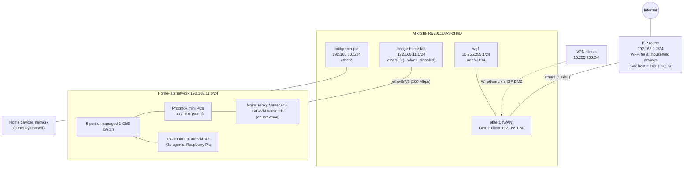

# home-lab-mikrotik-gateway-iac

Documentation of the MikroTik gateway that fronts the home lab, captured **as it is configured today**
(RouterOS 7.24.4, snapshot taken 2026-11-02). IaC for this router is a later phase; this README is the
reference the IaC will be built (and verified) against.

> **Scope.** This repo owns the *router view* only: ports, bridges, DHCP, DNS, firewall/NAT, WireGuard and the
> management plane. The global addressing plan, the `*.begoodguys.ovh` domain and service catalog, hardware
> inventory, energy cost and general security posture live in
> [`bounteous17/home-lab-briefing`](https://github.com/bounteous17/home-lab-briefing) and are linked, not restated, here.
>
> **Redaction.** Passwords, WireGuard keys, public WAN IPs, the router serial number (and the DDNS name derived
> from it) and full MAC addresses are intentionally omitted. MACs are referred to by vendor (OUI) only.

## Contents

1. [At a glance](#at-a-glance)
2. [Topology](#topology)
3. [Interfaces and bridges](#1-interfaces-and-bridges)
4. [Upstream / WAN](#2-upstream--wan)
5. [DHCP servers and reservations](#3-dhcp-servers-and-reservations)
6. [DNS](#4-dns)
7. [Firewall filter](#5-firewall-filter)
8. [NAT and hairpin NAT](#6-nat-and-hairpin-nat)
9. [WireGuard](#7-wireguard)
10. [Management plane](#8-management-plane)
11. [Known issues and recommended improvements](#9-known-issues-and-recommended-improvements)
12. [Roadmap](#10-roadmap)

## At a glance

| Item | Value |
|---|---|
| Model | MikroTik RB2011UiAS-2HnD (MIPS 74Kc 600 MHz, 128 MiB RAM, 128 MiB flash) |
| RouterOS | 7.24.4 (stable), packages: `routeros`, `wireless` |
| RouterBoard firmware | **3.33 running, 7.24.4 available** (not yet upgraded) |
| Role | Gateway for the home-lab network, **behind the ISP router** (as its DMZ host) |
| WAN | `ether1`, DHCP client, `192.168.1.50/24` (reserved on the ISP router), gateway `192.168.1.1` |
| Networks | `bridge-home-lab` 192.168.11.0/24 · `bridge-people` 192.168.10.0/24 · `wg1` 10.255.255.0/24 |
| Wi-Fi | `wlan1` present but **disabled**; household Wi-Fi is provided by the ISP router |
| IPv6 | Disabled globally |
| Identity | `MikroTik` (default) |

Addressing plan, service catalog and host inventory: see the
[briefing repo](https://github.com/bounteous17/home-lab-briefing).

## Topology

The MikroTik is **not** the home's main router. The ISP router (192.168.1.0/24) forwards everything to it as its
DMZ host, which makes the MikroTik the effective internet edge for the lab *and* a second NAT hop (double NAT).

Traffic paths in one line each:

- **Internet → lab (WireGuard):** ISP router DMZ → `ether1` udp/41194 → `wg1`; the only supported way to reach the
  catalog from outside.
- **Internet / ISP LAN → 80, 443:** public DNS (OVH) → the ISP fibre public IP → ISP DMZ → `ether1` (`192.168.1.50`) → dst-NAT
  → Nginx Proxy Manager on Proxmox → LXC/k3s backends. **This path is open to the Internet at the router level**; see
  [Is 80/443 reachable from the Internet?](#is-80443-reachable-from-the-internet).
- **Lab → internet:** `bridge-home-lab` → `ether1` (masquerade) → ISP router (second NAT) → internet.

## 1. Interfaces and bridges

### Port map

| Port | Switch chip | Link (snapshot) | Assignment | Notes |
|---|---|---|---|---|
| `ether1` | switch1 | up, 1 Gbps | **WAN** to ISP router | Not a bridge port; DHCP client |
| `ether2` | switch1 | no link | `bridge-people` | Only port of the "people" network |
| `ether3` | switch1 | no link | `bridge-home-lab` | Free gigabit port |
| `ether4` | switch1 | no link | `bridge-home-lab` | Free gigabit port |
| `ether5` | switch1 | no link | `bridge-home-lab` | Free gigabit port |
| `ether6` | switch2 | up, **100 Mbps** | `bridge-home-lab` | 4 remote MACs learned behind it |
| `ether7` | switch2 | up, **100 Mbps** | `bridge-home-lab` | 4 remote MACs learned behind it |
| `ether8` | switch2 | up, **100 Mbps** | `bridge-home-lab` | 1 remote MAC learned behind it |
| `ether9` | switch2 | no link | `bridge-home-lab` | |
| `ether10` | switch2 | no link | **none** (not in any bridge) | PoE-out port, priority 10, power-cycle ping off |
| `sfp1` | switch1 | disabled | none | Administratively disabled |
| `wlan1` | – | disabled | `bridge-home-lab` | See [Wi-Fi](#wi-fi) |
| `wg1` | – | running | WireGuard | See [section 7](#7-wireguard) |

Which device sits on which port can only be partly inferred from the bridge host table: the ARP/lease view shows
Proxmox mini PCs (.100/.101), Proxmox guests (QEMU/Proxmox OUI) and Raspberry Pis (RPi OUI) all in
`bridge-home-lab`, reachable through `ether6`/`ether7`/`ether8` (the multiple MACs per port indicate downstream
switching, i.e. the external unmanaged switch and/or hypervisor bridges). The authoritative physical wiring belongs in the
[briefing repo](https://github.com/bounteous17/home-lab-briefing).

> **Port speed caveat.** On the RB2011UiAS only `ether1`–`ether5` (and `sfp1`) are gigabit; `ether6`–`ether10` are
> 10/100 ports on a second switch chip. All three active lab uplinks (`ether6/7/8`) negotiate **100 Mbps**, so
> "1 GbE" in the lab only holds for the external switch's own ports and for `ether3`–`ether5` if used.

### Bridges

| Bridge | Address | Member ports | Purpose |
|---|---|---|---|
| `bridge-home-lab` | 192.168.11.1/24 | `ether3`–`ether9`, `wlan1` | All home-lab devices |
| `bridge-people` | 192.168.10.1/24 | `ether2` | Home-devices network, currently unused |

- **Hardware offload:** enabled on all Ethernet bridge ports (`hw=yes`; `H` flag on the active ones). Bridge
  fast-path is active. `wlan1` cannot be offloaded (wireless) – irrelevant while disabled.
- **VLANs:** none (no `vlan-filtering`, no VLAN interfaces, `ingress-filtering=no`). Segregation is by separate bridges only.
- **STP:** default (RSTP-capable, path-cost 10); no BPDU guard, edge ports left on `auto`.
- **MTU:** 1500 on all Ethernet/bridge interfaces (L2MTU 1598); `wg1` MTU **1420**.
- **IP firewall for bridged traffic:** `use-ip-firewall=no` – filter/NAT rules never see L2-bridged traffic.
- **PoE:** only `ether10` has PoE-out and nothing is plugged into it. No other port provides PoE.
- **Neighbor discovery / MAC server:** discovery (CDP/LLDP/MNDP) runs on all *static* interfaces, **including `ether1`**;
  MAC-telnet and MAC-winbox are allowed on all interfaces.

### Wi-Fi

`wlan1` (Atheros AR9300, 2.4 GHz, SSID `MikroTik`, country Spain, security profile `default`) is **disabled on
purpose**: the ISP router already provides Wi-Fi for every household device, and a second AP on the lab bridge would
expose the lab network to wireless clients. It is still a member of `bridge-home-lab`, so enabling it would put
Wi-Fi clients straight into the lab.

Two schedulers (`CronDisableWLAN` at 01:30, `CronEnableWLAN` at 06:30) are left over from when Wi-Fi was used; they
call scripts `DisableWLAN`/`EnableWLAN` that **no longer exist**, so they do nothing (run-count 0).
A `/interface wifi security` profile exists but there is no `wifi` package installed (leftover).

## 2. Upstream / WAN

| Setting | Value |
|---|---|
| Interface | `ether1` (to the ISP router) |
| Method | DHCP client `client1` (`add-default-route=yes`, distance 1, `use-peer-dns=yes`, `use-peer-ntp=yes`) |
| Address | `192.168.1.50/24`, reserved on the ISP router by the operator |
| Gateway | `192.168.1.1` (ISP router) |
| DNS learned via DHCP | `1.1.1.1`, `1.0.0.1` (Cloudflare) |
| Default route | `0.0.0.0/0 → 192.168.1.1`, distance 1, no gateway check |
| Other routes | connected only: 192.168.1.0/24, 192.168.10.0/24, 192.168.11.0/24, 10.255.255.0/24 |

**Double NAT / DMZ implications**

- The ISP router NATs the MikroTik; the MikroTik masquerades the lab on `ether1`. The MikroTik therefore only ever sees
  the ISP router's address as the L3 neighbour, and Internet-sourced connections may arrive with a rewritten source
  address (so source-based filtering on `ether1` is of limited use). WireGuard peers are identified by key, so they are
  unaffected.
- **DMZ means every port of the MikroTik's WAN address is reachable from the Internet**, not just the forwarded
  ones. With the current filter (no input drop) that includes the router's own services (see [section 5](#5-firewall-filter)
  and [section 9](#9-known-issues-and-recommended-improvements)).
- Anything on the ISP LAN (192.168.1.0/24) can also reach `192.168.1.50` directly – the same `ether1` rules apply to it.
- `/ip cloud` DDNS is enabled (5-minute updates) and keeps a `*.sn.mynetname.net` name pointing at the current public IP.
  RouterOS warns it is behind a NAT; the name resolves to the **ISP router's** public IP, which only works because of the DMZ.
- The ISP router provides no IPv6 to the MikroTik; IPv6 is disabled.

## 3. DHCP servers and reservations

| Server | Interface | Pool | Lease time | DNS handed to clients | Gateway |
|---|---|---|---|---|---|
| `dhcp1` | `bridge-people` | 192.168.10.2–.254 | 10 m | 1.1.1.1, 1.0.0.1 | 192.168.10.1 |
| `dhcp2` | `bridge-home-lab` | 192.168.11.2–.254 | 10 m | 1.1.1.1, 1.0.0.1 | 192.168.11.1 |

Clients are given Cloudflare DNS directly, **not** the router as resolver (see [DNS](#4-dns)).

### Static reservations (`bridge-home-lab`, `dhcp2`)

Reservations are bound by MAC with a matching client-id. Roles are the router's best view (hostname seen in the lease
and OUI); the authoritative host inventory is in the [briefing repo](https://github.com/bounteous17/home-lab-briefing).

| IP | Lease hostname | NIC vendor (OUI) | Role | Note |
|---|---|---|---|---|
| 192.168.11.50 | `panda` (**stale**) | Proxmox mini PC NIC (host is now static on .100) | Proxmox guest (see [home-lab-proxmox-ansible](https://github.com/bounteous17/home-lab-proxmox-ansible)) | Reservation is bound to the mini PC's NIC, but that host now uses static `.100`; `.50` is currently answered by a Proxmox guest MAC. |
| 192.168.11.51 | `octopus` (**stale**) | Proxmox mini PC NIC (host is now static on .101) | Proxmox guest (see [home-lab-proxmox-ansible](https://github.com/bounteous17/home-lab-proxmox-ansible)) | Same situation: reservation bound to the mini PC's NIC, host now static `.101`; `.51` is answered by a Proxmox guest MAC. |
| 192.168.11.150 | `lion` | Raspberry Pi | k3s agent (Raspberry Pi 4B) | Moved from `.100` on 2026-11-02 (collided with Proxmox node panda's static IP); now bound |
| 192.168.11.151 | `eagle` | Raspberry Pi | k3s agent (Raspberry Pi 4B) | Moved from `.101` on 2026-11-02 (collided with Proxmox node octopus's static IP); now bound |

> `192.168.11.100` (Proxmox node `panda`) and `.101` (Proxmox node `octopus`) are **static on the hosts, not router
> reservations**, and they sit inside the DHCP pool (`.2–.254`), which is precisely how the lion/eagle collision happened. See
> [section 9](#9-known-issues-and-recommended-improvements).

### Dynamic leases seen at snapshot time

| IP | Hostname | Probable role |
|---|---|---|
| 192.168.11.47 | `k3s-control-plane` | k3s control-plane VM (Proxmox guest) |
| 192.168.11.48 | `home-lab-k3s-cluster-prod-penguin` | k3s agent Pi (RPi OUI) |
| 192.168.11.49 | `home-lab-k3s-cluster-prod-shark` | k3s agent Pi (RPi OUI) |

These are ordinary dynamic leases (10-minute lease time; they keep the same address only by renewal), so they are not
pinned. Nginx Proxy Manager answers on `192.168.11.50` (target of NAT rules 2/3) with a static address on the
Proxmox guest, not a DHCP lease.

`bridge-people` (192.168.10.0/24) has no reservations and no active leases.

## 4. DNS

`/ip dns`:

| Setting | Value |
|---|---|
| `allow-remote-requests` | **yes** (router is a resolver for any client that can reach it) |
| Upstream servers | 1.1.1.1, 1.0.0.1 |
| DNS-over-HTTPS | `https://1.1.1.1/dns-query`, `verify-doh-cert=yes` |
| Cache | 2048 KiB, `cache-max-ttl=1d` |

### Static entries

| Name | Type | Value | State | Purpose |
|---|---|---|---|---|
| `jellyfin.home-lab.begoodguys.ovh` | A | 192.168.1.50 | enabled | Clients that query the MikroTik resolve the Jellyfin name straight to the MikroTik's `ether1` address, avoiding the ISP router's missing NAT hairpin. |
| `<serial>.sn.mynetname.net` | A | 192.168.1.50 | **disabled** | Former override for the DDNS CNAME target used by the Jellyfin iOS app. |

Observations:

- This is a **minimal split-horizon**: exactly one `begoodguys.ovh` name is overridden. All other
  `*.begoodguys.ovh` names are resolved by Cloudflare/public DNS.
- **Deprecated naming:** `*.home-lab.begoodguys.ovh` is the old scheme. Catalog services now use
  `<service>.begoodguys.ovh` (see the [briefing repo](https://github.com/bounteous17/home-lab-briefing)); the
  `jellyfin.home-lab…` entry is legacy and should be removed with the other legacy items.
- DHCP clients in both bridges are told to use 1.1.1.1/1.0.0.1, **not** the router, so they never see the override;
  it only helps devices that explicitly use the MikroTik as resolver.
- WireGuard clients are configured with 1.1.1.1 (and 1.0.0.1 for two of the three peers) as DNS, not the router.
  Catalog names therefore have to resolve through public DNS (see the
  [briefing repo](https://github.com/bounteous17/home-lab-briefing) for how the catalog domain is published).
- No DNS rebinding protection/filtering, and no `allow-remote-requests` restriction (see [section 9](#9-known-issues-and-recommended-improvements)).

## 5. Firewall filter

`/ip firewall filter` is tiny: four user rules plus RouterOS's dynamic FastTrack counter rule.
Evaluated top to bottom:

| # | Chain | Match | Action | Intent |
|---|---|---|---|---|
| 0 (dyn) | forward | – | passthrough | Dummy rule that shows FastTrack counters |
| 1 | forward | `connection-state=established,related` | **fasttrack-connection** | Offload established flows to the fast path (~9.5 GB so far); important on a 600 MHz single-core CPU |
| 2 | forward | `connection-state=established,related`, `connection-nat-state=""` | accept | Accept established, non-NAT'd flows that FastTrack does not take |
| 3 | input | `protocol=udp dst-port=41194` | accept | "Allow WG service from external": WireGuard handshake from the Internet (and the ISP LAN) |
| 4 | forward | `in-interface=wg1` | accept | "Allow WG Forward": VPN clients may go anywhere (both bridges, the Internet) |

There are **no `drop` rules in any chain**, no `invalid` handling, no interface lists (only the built-in `all`/`none`/
`dynamic`/`static`) and no per-bridge segregation. Everything not explicitly accepted is therefore still accepted by the
implicit default. Practical effects:

- Router `input`: protected only by per-service `available-from` lists, not by the firewall (see [section 8](#8-management-plane)).
- `forward`: `bridge-people` ↔ `bridge-home-lab` ↔ `ether1` ↔ `wg1` can all talk to each other, subject to NAT rules.
- Because the router is an Internet-facing DMZ host, **the lab network and the router are reachable from the Internet to
  the extent the NAT rules below allow** (inbound new connections only arrive through dst-NAT; the rest is blocked only by
  the absence of a route/mapping, not by a rule).

**Address lists**

| List | Entries | Purpose |
|---|---|---|
| `wan-ip` | the DDNS name (resolved, currently the public IP – dynamic entry); `192.168.1.50` (static) | "Own WAN address" set used by the hairpin dst-NAT rules |

**Interface lists:** only the built-in ones; no custom `WAN`/`LAN` lists.

## 6. NAT and hairpin NAT

### Rule walkthrough (`/ip firewall nat`, in order)

Live table after the 2026-11-02 cleanup (six rules):

| # | Chain | Match | Action | Intent |
|---|---|---|---|---|
| 0 | srcnat | src 192.168.11.0/24 → dst 192.168.11.0/24, out `bridge-home-lab` | masquerade | Hairpin NAT for the lab bridge |
| 1 | srcnat | src 192.168.10.0/24 → dst 192.168.10.0/24, out `bridge-people` | masquerade | Hairpin NAT for the people bridge |
| 2 | dstnat | `dst-address-list=wan-ip` tcp/80 | dst-nat → 192.168.11.50:80 | **Ingress** to NPM: WAN 80 (and hairpin for lab/VPN clients hitting the WAN address) |
| 3 | dstnat | `dst-address-list=wan-ip`, tcp/443 | dst-nat → 192.168.11.50:443 | **Ingress** to NPM: WAN 443 (and hairpin, same as above) |
| 4 | srcnat | `out-interface=ether1` | masquerade | Normal outbound NAT for the lab, people net and VPN clients |
| 5 | srcnat | dst 10.255.255.0/24, out `ether1` | masquerade | "WG NAT" – see note |

### How hairpin NAT is implemented, and why it is needed

Problem: devices inside the lab/ISP LAN resolve a public name (for example `jellyfin.home-lab.begoodguys.ovh`) to the
WAN address (the public IP, or the router's own `192.168.1.50`) and try to connect to it. Without help:

1. The packet goes to the router, which dst-NATs it to a backend **on the same subnet as the client**.
2. The backend replies **directly** to the client (same L2 segment), so the client sees a reply from an address it never
   contacted and drops it. The connection hangs.
3. With the **double-NAT/DMZ** topology it is worse: for clients on the ISP LAN the ISP router would need its own
   hairpin/NAT loopback, which it does not offer.

How this router solves it:

- **dst-NAT on "own WAN address" (rules 2/3):** `dst-address-list=wan-ip` contains both the DDNS-resolved public IP
  and `192.168.1.50`. Any connection to either address on 80/443, whatever the ingress interface (`ether1`, `bridge-home-lab`,
  `bridge-people` or the VPN), is redirected to `192.168.11.50:80/443`.
- **Source masquerade on the same bridge (rules 0/1):** when client and backend are in the same subnet, the srcnat
  masquerade (src = dst subnet, out-interface = that bridge) rewrites the source to the router's address so the
  backend answers **back through the router**, where the reverse NAT happens. Pure L2 traffic is not affected
  (the bridge does not pass bridged frames through the IP firewall), only traffic that has been routed/dst-NATed.
- **DNS override (see [DNS](#4-dns)):** for clients that use the MikroTik as resolver, `jellyfin.home-lab…` resolves to
  `192.168.1.50`, so the connection always lands on the router instead of on the public IP behind the ISP router.
- **Why the `wan-ip` list contains both addresses:** the DDNS name tracks the public IP (for clients that resolve public
  DNS) and `192.168.1.50` covers clients that were steered to the router's `ether1` address.

Notes on specific rules:

- Rules 2/3 have no `in-interface` or source match, so **any** host on the ISP LAN reaching `192.168.1.50:80/443` is
  forwarded to NPM the same way as Internet traffic (see [section 7](#is-80443-reachable-from-the-internet)).
- Rule 5 ("WG NAT": `dst-address=10.255.255.0/24`, `out-interface=ether1`) does not appear to match any real flow: traffic
  to VPN clients leaves via `wg1`, not `ether1`. Outbound traffic from VPN clients is already covered by rule 4.

## 7. WireGuard

| Item | Value |
|---|---|
| Interface | `wg1` ("Home lab full access") |
| Address | 10.255.255.1/24 |
| Listen port | udp/**41194**, accepted in `input` (rule 3) |
| MTU | 1420 |
| Reaching it from outside | Via the ISP router DMZ to `192.168.1.50`, using the DDNS-backed hostname configured as endpoint in the client configs |

Peers (keys, public endpoints and personal peer names deliberately omitted):

| Peer | Allowed address | Client DNS in exported config |
|---|---|---|
| laptop (operator) | 10.255.255.2/32 | 1.1.1.1, 1.0.0.1 |
| phone (operator) | 10.255.255.3/32 | 1.1.1.1, 1.0.0.1 |
| phone (household member) | 10.255.255.4/32 | 1.1.1.1 |

How VPN clients reach the lab:

1. The client connects to the DDNS hostname on udp/41194; the ISP DMZ hands it to `ether1`, `input` rule 3 accepts it.
2. The client gets a /32 inside 10.255.255.0/24; routes to 192.168.10.0/24, 192.168.11.0/24 (and optionally everything)
   are chosen in the **client** config, not on the router.
3. `forward` rule 4 accepts everything coming from `wg1`, so a client can reach `bridge-home-lab`, `bridge-people`
   and the Internet (masqueraded by rule 4). There is **no per-peer restriction**: every peer has the same "full access".
4. DNS: peers use Cloudflare, not the router, so catalog hostnames (`*.begoodguys.ovh`) must resolve publicly
   to an address the VPN can route (see the [briefing repo](https://github.com/bounteous17/home-lab-briefing)).
   NPM (on Proxmox) then terminates TLS and proxies to the LXC/VM backends.

The catalog is meant to be used only from the home-lab network and WireGuard. The router does not enforce that;
see the next section.

### Is 80/443 reachable from the Internet?

**Yes. Since 2026-11-02 it is verified reachable from the Internet, and no router rule restricts who can use it.**

Context: public DNS for `*.begoodguys.ovh` at OVH points to the MikroTik's `/ip cloud` DDNS name, i.e. to the ISP fibre
public IP (neither is published here). The ISP router's DMZ forwards all inbound traffic to `192.168.1.50`, where the
MikroTik dst-NATs TCP 80/443 to NPM on Proxmox, which proxies to LXC containers or k3s. The hairpin NAT exists so lab and
VPN clients that resolve the public IP still reach NPM.

**Intended policy:** catalog services are for the **home-lab LAN and WireGuard clients only**.

**What the router enforces today: nothing.** (Verified read-only on the live config.)

| Check | Finding |
|---|---|
| `src-address` / `src-address-list` on the dst-NAT rules (2, 3) | **None.** They match only `dst-address-list=wan-ip` (the router's own addresses). |
| `forward` drop / "allow only lab and VPN" rule | **None.** The forward chain has no drop; it has FastTrack, established/related accept and "accept from `wg1`". |
| `input` drop | **None**, so the router's own services are not firewalled either. |
| Address list restricting sources | The only list, `wan-ip`, holds the router's *own* addresses (destination match), not allowed clients. |
| Upstream | The ISP router DMZ forwards everything, so nothing upstream filters 80/443 either. |

Enforcement therefore depends **entirely on NPM** (access lists on its proxy hosts), which is out of scope for this repo
(see [`home-lab-proxmox-ansible`](https://github.com/bounteous17/home-lab-proxmox-ansible)) and cannot be verified from the
router. Any host that sends TCP 80/443 to the public IP, or to `192.168.1.50` from the ISP LAN, is delivered to the next hop;
what it gets depends on NPM. This is tracked as the top item in [section 9](#9-known-issues-and-recommended-improvements).

**Verified 2026-11-02 (external probing):** TCP 80 and 443 on the public IP are reachable from the Internet, so with the
DMZ strategy **all catalog services published through NPM are public**, e.g. `https://vaultwarden.begoodguys.ovh/`
returns the Vaultwarden login page from outside. NPM's access-list behaviour was not inspected.

**Incident fixed the same day (443 not reachable from outside).** NAT rule 3 carried `dst-address-type=unicast`.
Internet traffic arrives through the DMZ with destination `192.168.1.50`, which is the router's own `ether1` address
(address type `local`), so rule 3 never matched it; the packet was handled as traffic for the router and refused. Port 80
(rule 2, no address-type match) worked. Hairpin traffic from the lab matched rule 3 only because it targets the public IP,
which is not a local address, so the fault was invisible from inside. Fix: `dst-address-type` removed from rule 3, and the
`reverse-proxy` service on 443 disabled. Diagnosis tip: probe from outside the network (a test from the lab goes through the
hairpin path) and compare the NAT rule counters before and after.

## 8. Management plane

### Management access

The operator manages the router over **WireGuard (10.255.255.0/24)** and from the **home-lab bridge (192.168.11.0/24)**.
SSH and Winbox allow exactly those two networks (corrected 2026-11-02; previously Winbox allowed `192.168.0.0/24`, a typo,
and SSH allowed `192.168.10.0/24`). The **ISP LAN (192.168.1.0/24) and `bridge-people` (192.168.10.0/24) are not allowed**,
so management from them is refused. WebFig (`www-ssl`) is disabled. No firewall rule backs these lists (see
[section 5](#5-firewall-filter)); they are the only protection of the services.

### IP services

| Service | Port | State | Allowed from |
|---|---|---|---|
| ssh | 22 | enabled (host key type `ed25519`) | 192.168.11.0/24, 10.255.255.0/24 |
| winbox | 8291 | enabled | 192.168.11.0/24, 10.255.255.0/24 |
| www-ssl | 443 | disabled (TLS 1.2 only, `webfig` certificate; list is `192.168.10.0/24` if re-enabled) | – |
| www | 8080 | disabled | – |
| ftp | 21 | disabled | – |
| telnet | 23 | disabled | – |
| api / api-ssl | 8728 / 8729 | disabled | – |
| `btest` (bandwidth test) | 2000 | enabled (system default) | any |
| `reverse-proxy` (443 service, no cert) | 443 | disabled 2026-11-02 | – |

Other management surface: MAC-telnet/MAC-winbox on all interfaces, neighbor discovery (CDP/LLDP/MNDP) on static
interfaces including `ether1`, SNMP off, UPnP off, web proxy off, SOCKS off.

### Users

| User | Group | Status |
|---|---|---|
| `admin` | full | disabled (default user) |
| `bounteous` | full | enabled (no secrets recorded here) |

Groups are the three RouterOS defaults (`read`, `write`, `full`).

### Time, logging, backups, versions

| Area | Current state |
|---|---|
| Time zone | `Europe/Madrid` |
| NTP client | **disabled** (`/system ntp client enabled=no`); time is taken from `/ip cloud` (`update-time=yes`) |
| Logging | RouterOS defaults: `info`, `error`, `warning` to memory, `critical` echoed; **no remote syslog, no disk log** |
| Config backups | On-device files only: binary backups from 2025-11-11 and 2026-01-24, plus `.rsc` exports (`config.rsc` 2025-11-11, `backup-before-multi-node.rsc` 2026-01-24). Nothing recent, nothing off-box, no scheduled backup. |
| Other files | Old certificate exports (2019, 2025), `autosupout.rif` (2020), `console-dump.txt`, default `pub`/`skins` |
| RouterOS | 7.24.4 (build 2026-09-16) |
| RouterBoard firmware | 3.33 (current) vs **7.24.4 available** |
| Resources | 128 MiB RAM (≈72 MiB free), single 600 MHz core, ≈40 % CPU at snapshot time |
| Scheduled jobs | `CronDisableWLAN`/`CronEnableWLAN` (broken, see [Wi-Fi](#wi-fi)) |
| Netwatch | 4 node monitors that toggle the NAT rules |
| Defaults still present | LTE APN, L2TP/OVPN server defaults (disabled), BFD default config, LCD disabled |

### Practice for exports

Export read-only with the default `export` (sensitive values hidden, never `show-sensitive`); example:
`ssh bounteous@192.168.11.1 '/export terse' > mikrotik-YYYY-MM-DD.rsc`. Review before committing: even the default
export contains WireGuard **public** keys, the serial number and the DDNS name, which must not be published
(see [Redaction](#home-lab-mikrotik-gateway-iac)).

## 9. Known issues and recommended improvements

Observations only – nothing below has been applied. Ordered roughly by impact. "Best practice" refers to common
home-lab/MikroTik hardening guidance.

| # | Observation | Why it matters | Suggested direction |
|---|---|---|---|
| 1 | **HIGH: catalog exposure is not enforced by the router.** Intended policy is LAN + WireGuard only, but the 80/443 dst-NATs have no source restriction and there are no drop rules; enforcement depends solely on NPM (out of scope, [`home-lab-proxmox-ansible`](https://github.com/bounteous17/home-lab-proxmox-ansible)). | The ISP-DMZ makes 80/443 (and anything else) reachable from the Internet and the ISP LAN. A mistake in NPM exposes the catalog. | Add `src-address-list` (lab, VPN) to rules 2/3 and/or drop new dst-NATed connections from `ether1` except from allowed sources; use `connection-nat-state=dstnat` in `forward`. |
| 2 | **HIGH: no default-drop in `input`.** Only a WireGuard accept exists. | Router services reachable from `ether1` are effectively on the Internet; SSH/Winbox/web are limited only by `available-from`, and DNS, `btest` and MAC services are unrestricted. | Standard input chain: accept established/related, drop invalid, accept WG, accept management from the lab/VPN/ISP-LAN lists, **drop the rest**. |
| 3 | **Open DNS resolver** (`allow-remote-requests=yes`, no input filtering). | Reachable via the DMZ; abusable for amplification. | Restrict udp/tcp 53 in `input` to the bridges and `wg1`. |
| 4 | **No forward drop / no segregation** between `ether1`, `bridge-people`, `bridge-home-lab`, `wg1`. | A device on the people network can reach the lab; any VPN peer can reach everything. | `LAN`/`WAN` interface lists, drop invalid, drop `WAN`→LAN that is not dst-NATed, block `bridge-people` → `bridge-home-lab`. |
| 5 | **Remaining legacy cleanup:** four netwatch monitors (now no-ops after the 2026-11-02 NAT cleanup), "traefik" comments on rules 2/3, deprecated `jellyfin.home-lab.begoodguys.ovh` static DNS entry. | Dead config and misleading labels; netwatch entries still ping hosts for nothing. | Remove them. |
| 6 | **Management `available-from` (fixed 2026-11-02, residual items).** SSH and Winbox now allow only `192.168.11.0/24` and `10.255.255.0/24`; WebFig is disabled. Still open: `btest` (any source), MAC-server/MAC-winbox on all interfaces, CDP/LLDP/MNDP on `ether1`. The lists are not backed by the firewall. | Management is refused from the ISP LAN and `bridge-people`, which is stricter than the earlier intent, but the open `btest`/MAC services are still reachable from `ether1`. | Add a `MGMT` list in `input` and drop the rest (see 2); disable `btest` and restrict MAC-server and discovery to the lab bridge. |
| 7 | **Static IPs inside the DHCP pool** (`.100/.101` vs `.2–.254`) and 10-minute leases. | Caused the lion/eagle collision; dynamic hosts (k3s control-plane/agents) drift. | Shrink pools (e.g. `.200–.254`), reserve long-lived hosts, raise the lease time. |
| 8 | **Stale panda/octopus reservations.** `.50`/`.51` are bound to the mini PCs' NICs, but those nodes are now static on `.100`/`.101`; `.50/.51` are answered by Proxmox guests. | Reservations point at hosts that no longer use them and can hand `.50/.51` to the wrong device. | Clean up the stale `panda`/`octopus` reservations; make the `.100/.101` reservations match the Proxmox nodes (or keep them static, outside the pool). |
| 9 | **Firmware 3.33 vs 7.24.4 available.** | RouterBOOT is far behind RouterOS. | Upgrade firmware (then reboot) in a maintenance window. |
| 10 | **Backups are stale and on-box only** (2025-11, 2026-01; no schedule). | Flash failure loses the only copies. | Scheduled sanitized `/export` + binary backup off-box. |
| 11 | **NTP client disabled**, time from `/ip cloud`. | Time depends on a MikroTik service. | Enable the NTP client. |
| 12 | **Logging is memory-only.** | Lost on reboot; no audit trail for an Internet-exposed router. | Remote syslog or disk action; log dropped `input` from `ether1`. |
| 13 | **FastTrack without a surrounding ruleset.** | Nothing protects the forward path. | Keep FastTrack, after the `invalid` drop. |
| 14 | **DNS handled outside the router.** Clients and VPN peers use 1.1.1.1; the single split-horizon entry is never used by them. | Overrides only help clients that query the router. | Hand out the router (or an internal resolver) and add overrides there. |
| 15 | **Leftover config:** broken `CronDisable/EnableWLAN`, disabled `wlan1` still bridged, unused `wifi` security profile, disabled DNS entry, old cert/RIF files, `ether10` unbridged. | Noise for future IaC. | Remove or document before codifying. |
| 16 | **Rule 5 ("WG NAT") likely ineffective.** | See [section 6](#6-nat-and-hairpin-nat). | Drop it or confirm its purpose. |
| 17 | **Lab uplinks at 100 Mbps** (`ether6/7/8`). | The RB2011's `ether6–10` are Fast Ethernet; `ether3–5` are free gigabit. | Move uplinks to `ether3`–`ether5`. |
| 18 | **Discovery protocols and MAC server on `ether1`.** | Leaks router identity to the ISP LAN. | Restrict to a LAN list. |
| 19 | **Single point of failure:** one router, one uplink, no failover. | Router loss takes the lab and VPN down. | Keep a recent off-box backup and a documented recovery path. |

## 10. Roadmap

Planned, **not done**:

1. **Firewall hardening:** default-drop `input` and `forward`; close the open DNS resolver; isolate `bridge-people` from
   `bridge-home-lab`; restrict the 80/443 dst-NATs to allowed sources (lab + WireGuard); remove the remaining legacy netwatch monitors and the deprecated Jellyfin DNS entry.
2. **Uplinks:** move the lab uplinks from 100 Mbps `ether6`–`ether8` to gigabit `ether3`–`ether5`.
3. **Off-box config backups:** scheduled, sanitized export.

**Not planned yet:** monitoring/logging, IPv6, VLANs, WAN failover.

## Related

- Briefing repo (addressing plan, domain and service catalog, hardware inventory, energy cost, security posture):
  <https://github.com/bounteous17/home-lab-briefing>
